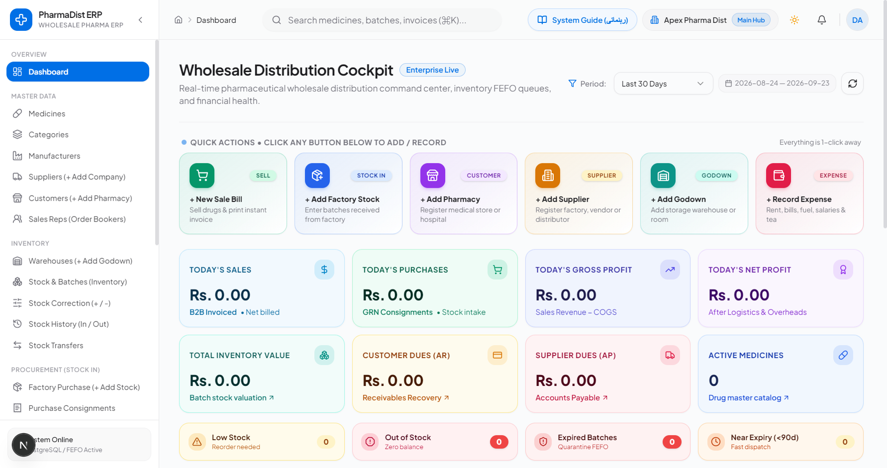
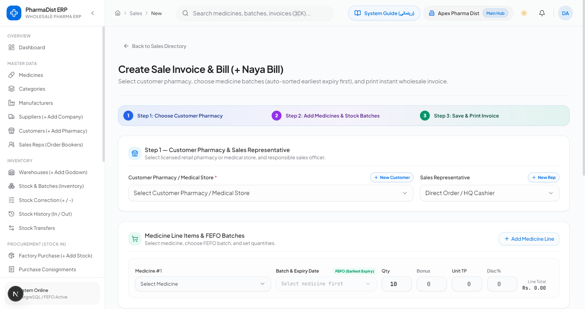
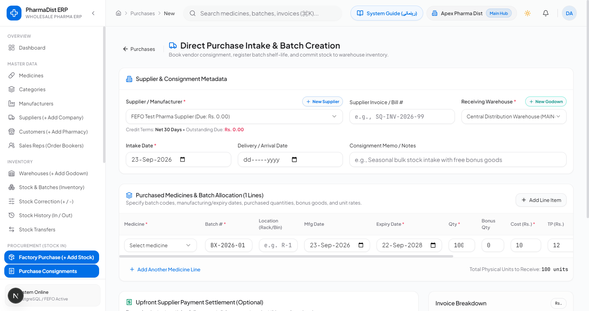
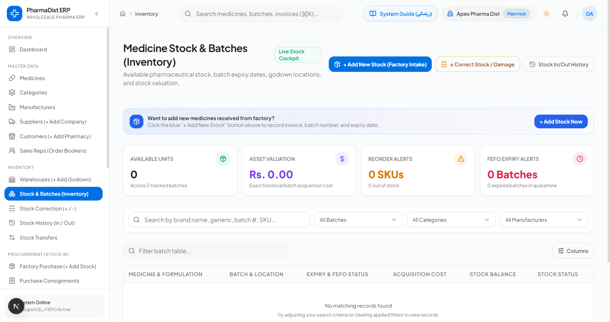
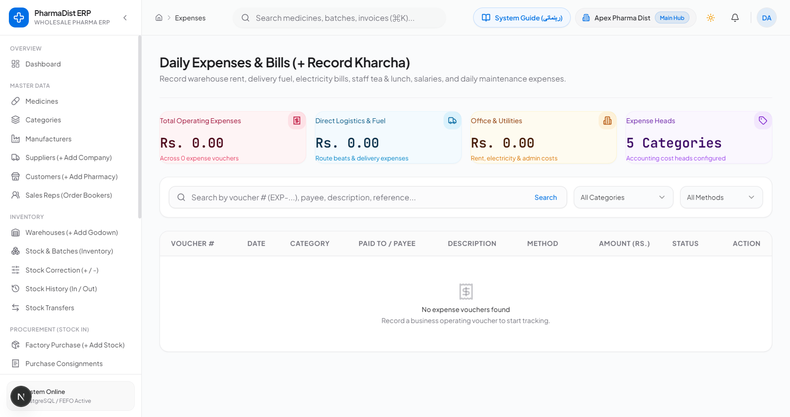
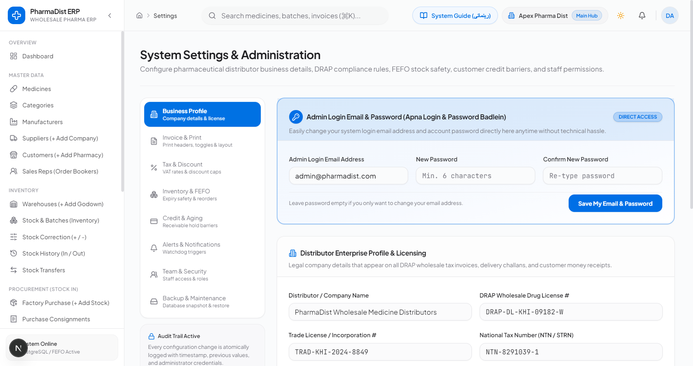

# PharmaDist — Wholesale Medicine Distribution Management System

An enterprise-oriented ERP for wholesale pharmaceutical distributors, stockists, and medicine suppliers. The application models the operational flow from procurement and batch-controlled inventory through sales, collections, expenses, and financial reporting.

## Core workflows

- **Medicine and batch management:** Maintain medicine records, batch details, pricing, and expiry dates.
- **FEFO inventory:** Prioritize stock with the earliest expiry date for eligible sales.
- **Purchasing and suppliers:** Record supplier purchases and manage supplier balances.
- **Wholesale sales:** Create pharmacy sales, invoices, and delivery documents.
- **Customer accounts:** Track pharmacy balances, credit limits, and receivables.
- **Payments and expenses:** Record collections, supplier payments, and operating expenses.
- **Financial reporting:** Review cost of goods sold, gross margin, net margin, and operational reports.
- **Administration:** Manage users and permissions, system settings, notifications, and audit records.
- **Desktop packaging:** The repository also includes an Electron desktop application configuration.

## Technology

| Area | Stack |
|---|---|
| Web application | Next.js 15, App Router |
| Language | TypeScript |
| UI | Tailwind CSS, shadcn/ui, Lucide |
| Database | Supabase PostgreSQL |
| ORM | Prisma 6 |
| Authentication | Supabase Auth and SSR |
| Validation and forms | Zod, React Hook Form |
| Tables and charts | TanStack Table, Recharts |
| Email | Resend |
| Desktop | Electron |

## Requirements

- Node.js 20+
- npm
- A configured Supabase project and PostgreSQL connection

## Local setup

```bash
git clone https://github.com/00tatheer00/WholeSale-Distributor-System.git
cd WholeSale-Distributor-System
npm install
cp .env.example .env.local
```

Edit `.env.local` with your own Supabase URL, public key, server-side service-role key, database URLs, and email settings. Do not commit real credentials.

Generate the Prisma client and apply the current Prisma schema to your development database:

```bash
npm run prisma:generate
npm run prisma:push
```

For development-only seed data:

```bash
npm run db:seed
```

Start the web application:

```bash
npm run dev
```

Open [http://localhost:3000](http://localhost:3000).

## Useful scripts

| Command | Purpose |
|---|---|
| `npm run dev` | Start the Next.js development server |
| `npm run build` | Build the web application |
| `npm run start` | Start the production web server |
| `npm run typecheck` | Run TypeScript without emitting files |
| `npm run prisma:generate` | Generate Prisma Client |
| `npm run prisma:push` | Push the Prisma schema to the configured database |
| `npm run prisma:validate` | Validate the Prisma schema |
| `npm run db:seed` | Run the offline seed script |
| `npm run electron:dev` | Start the web app with the Electron shell |
| `npm run electron:build` | Build the Windows desktop installer |

Use `prisma:push` only where it is appropriate for your environment. Review the schema and back up important data before applying database changes.

## Product screenshots

The following screenshots show key workflows from the application:

| Dashboard | Sales |
|---|---|
|  |  |

| Purchasing | Inventory |
|---|---|
|  |  |

| Expenses | Settings |
|---|---|
|  |  |

## Documentation

- [Production deployment runbook](./docs/production-deployment.md)
- [Backup and recovery guide](./docs/backup-recovery.md)
- [Project status](./docs/PROJECT_STATUS.md)
- [Asan Roman Urdu user guide](./docs/ASAN_URDU_GUIDE.md)
- [Easy English user guide](./docs/EASY_ENGLISH_GUIDE.md)

The `docs/screenshots/` directory contains application screenshots used by the project guides.

## Verification

Run the checks available in the repository before opening a release or deploying:

```bash
npm run prisma:validate
npm run typecheck
npm run build
```

## Security

- Keep production credentials in your deployment provider's secret manager or a local ignored environment file.
- Never expose the Supabase service-role key to client-side code.
- Review Row Level Security policies and database access before production deployment.
- Back up the database before schema changes or upgrades.

## License

See the repository's [LICENSE](./LICENSE) file.

---

## Repository standards

- [Contribution guidelines](./CONTRIBUTING.md)
- [Security policy](./SECURITY.md)
- [Pull request template](./.github/PULL_REQUEST_TEMPLATE.md)
