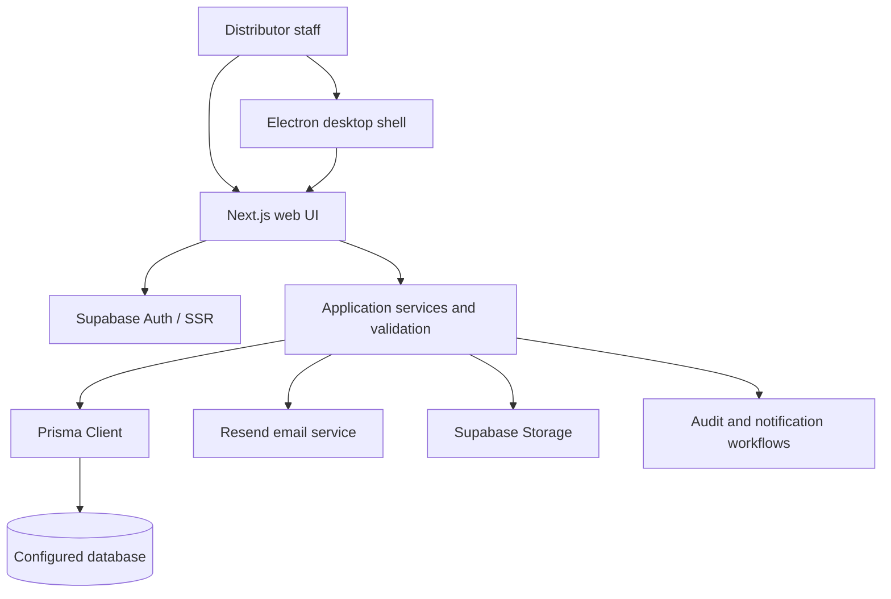

# PharmaDist Architecture

## System context

PharmaDist is a wholesale medicine distribution ERP with a Next.js web application, Prisma data layer, Supabase authentication, and an Electron desktop shell.

## Business domains

- Company, users, roles, and configuration
- Medicines, manufacturers, suppliers, and customers
- Warehouses, batches, expiry dates, and stock movements
- Procurement, sales, invoices, deliveries, and payments
- Customer receivables and supplier payables
- Expenses, cost of goods sold, profit, and reports
- Notifications, audit records, and administration

## Inventory and financial invariants

- Batch identity and expiry dates must be preserved through purchasing and sales.
- FEFO selection must be enforced by the transaction logic, not only by the UI.
- Stock movements and their corresponding financial effects should remain traceable.
- Cancellation and reversal operations must preserve the audit trail.
- Credit limits and payment allocation must be validated at the server/data layer.

## Repository layout

- `src/app/`: Next.js routes and application UI
- `src/components/`: reusable UI components
- `src/lib/`: shared services, validation, and infrastructure
- `prisma/schema.prisma`: Prisma data model
- `prisma/`: seed and database support
- `electron/`: desktop main and preload processes
- `docs/`: user, deployment, database, and recovery guides

## Deployment boundary

The repository contains both web and desktop packaging configuration. Confirm the active Prisma datasource, environment URL format, and migration strategy for the target deployment before applying database changes. Do not assume a development SQLite configuration and a hosted PostgreSQL configuration are interchangeable without verifying the schema and runtime adapters.
